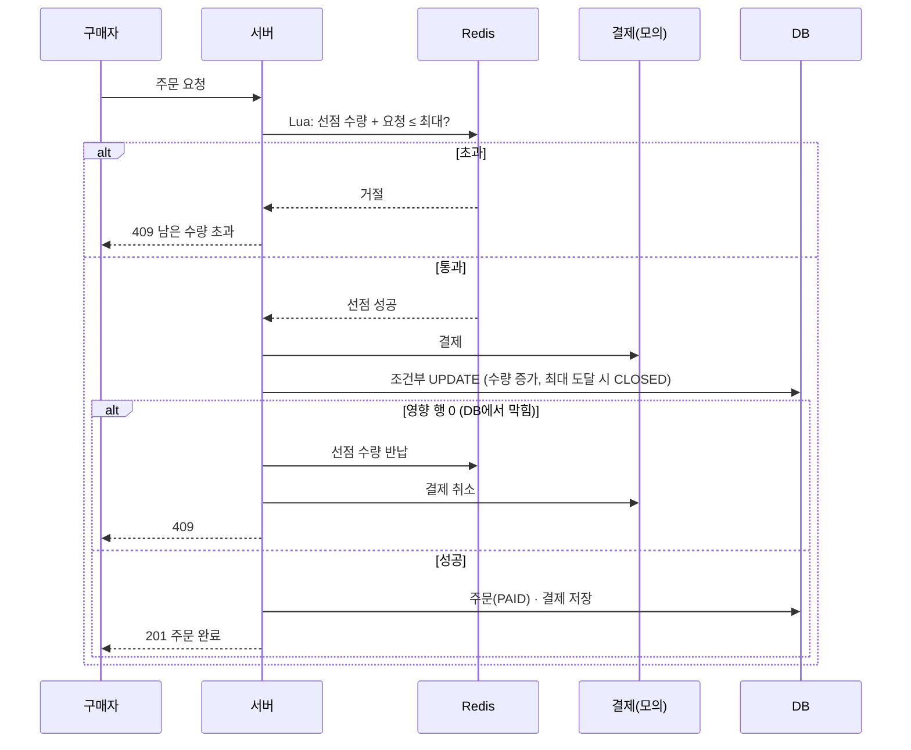

# MOA: 실시간 공동구매 플랫폼

> 한 상품을 여러 사람이 함께 대량 구매해 **도매가로 싸게 사는** 공동구매 서비스의 백엔드입니다.
> 여러 명이 동시에 결제해도 **정해진 수량을 넘겨 팔지 않도록** 동시성을 제어하고, 참여 현황을 **실시간(SSE)** 으로 보여줍니다.

https://youtu.be/tFwbJnYFTXQ


| 항목 | 내용 |
| --- | --- |
| 개발 기간 | 2026.11.05 ~ 2026.11.18 (10영업일) |
| 인원 | 1인 (백엔드 + 테스트용 웹 화면) |
| 성격 | 스파르타 KDT 실시간 커머스 과정 · 꿀알바 단기 개발 프로젝트 |

---

## 목차

1. [한눈에 보는 MOA](#1-한눈에-보는-moa)
2. [주요 기능](#2-주요-기능)
3. [사용 기술](#3-사용-기술)
4. [아키텍처](#4-아키텍처)
5. [데이터베이스 설계 (ERD)](#5-데이터베이스-설계-erd)
6. [API 목록](#6-api-목록)
7. [핵심 설계: 동시에 몰려도 초과 판매하지 않기](#7-핵심-설계-동시에-몰려도-초과-판매하지-않기)
8. [부하 테스트와 트러블슈팅](#8-부하-테스트와-트러블슈팅)
9. [실행 방법](#9-실행-방법)
10. [한계와 향후 개선](#10-한계와-향후-개선)

---

## 1. 한눈에 보는 MOA

### 공동구매가 뭔가요?

동네 마트에서 노트북 1대를 사면 100만 원이지만, 100명이 모여 한 번에 100대를 주문하면 도매가 80만 원에 살 수 있습니다. MOA는 이런 **"모여서 싸게 사기"** 를 온라인으로 하는 서비스입니다.

- **판매자**는 상품을 올리고 "도매가 80만 원, **목표 3대**, **최대 5대**, 마감은 내일 6시"처럼 공동구매를 엽니다.
- **구매자**는 마감 전에 참여(결제)합니다. 결제는 참여할 때 미리 합니다.
- **마감 시각**이 되면 결과가 정해집니다.
  - 목표 수량을 채웠으면 **성사**되어 구매가 확정됩니다.
  - 못 채웠으면 **실패**하고 참여자 전원에게 자동으로 환불됩니다.
- 최대 수량이 다 차면 마감 전이라도 **조기 마감**되어 더 이상 참여할 수 없습니다.

### 이 프로젝트에서 어려웠던 점

인기 상품은 마감 직전에 수십, 수백 명이 **같은 순간에** 결제 버튼을 누릅니다. 아무 대비 없이 처리하면 "남은 수량 1개"를 두 사람이 동시에 확인하고 둘 다 결제에 성공하는 **초과 판매**가 생깁니다. MOA는 이 문제를 Redis와 DB 두 단계로 막고, 실제로 100명 동시 결제 테스트(k6)로 검증했습니다.

### 전체 흐름


### 공동구매 상태 변화


| 상태 | 의미 | 참여 | 취소 |
| --- | --- | --- | --- |
| `OPEN` | 진행 중 | 가능 | 가능 |
| `CLOSED` | 최대 수량이 다 차서 조기 마감 | 불가 | 불가 |
| `SUCCEEDED` | 마감 시 목표 달성, 구매 확정 | 불가 | 불가 |
| `FAILED` | 마감 시 목표 미달, 전원 환불 | 불가 | 불가 |

---

## 2. 주요 기능

| 분류 | 기능 | 설명 |
| --- | --- | --- |
| 회원 | 회원가입 · 로그인 | 구매자(USER) / 판매자(SELLER). 로그인하면 JWT 토큰 발급. 가입할 때 장바구니 자동 생성 |
| 상품 | 등록 · 목록 · 상세 | 판매자만 등록. 목록과 상세는 로그인 없이 조회 |
| 공동구매 | 개설 · 진행 현황 조회 | 상품당 진행 중인 공동구매는 1개만. 현재 수량, 진행률(%), 남은 수량 제공 |
| 장바구니 | 담기 · 조회 · 수량 변경 · 삭제 | 같은 공동구매를 다시 담으면 수량 합산. 주문 가능 여부 표시 |
| 주문 · 결제 | 단건 주문 · 장바구니 묶음 주문 | 모의 결제. 묶음 주문은 **실패한 항목만 실패**하고 나머지는 그대로 성공 |
| 주문 · 결제 | 목록 · 상세 · 취소 | 공동구매가 진행 중(`OPEN`)일 때만 취소 가능. 취소하면 수량 복구, 환불 |
| 실시간 | 진행률 SSE | 주문·취소·마감 결과를 구독자 화면에 실시간 전송 |
| 자동 처리 | 마감 스케줄러 | 마감 시각이 지나면 성사/실패 판정 후 구매 확정 또는 전원 환불 |
| 테스트 화면 | 웹 테스트 페이지 | 회원·상품·장바구니·주문·실시간 탭, 요청/응답 로그 패널 |

> 상품 채팅방과 AI 챗봇(Ollama)은 이번 제출 범위에서 제외했고 이후 구현할 예정입니다. 상품 등록 시 채팅방 테이블(`chat_rooms`)만 함께 만들어 둡니다.


---

## 3. 사용 기술

| 구분 | 기술 | 사용한 곳 |
| --- | --- | --- |
| 언어 · 프레임워크 | Java 17, Spring Boot 4.1 | 전체 |
| 데이터 | Spring Data JPA, H2 (MySQL 호환 모드) | 엔티티, 조회. 핵심 쿼리는 MySQL 문법 네이티브 쿼리로 직접 작성 |
| 캐시 · 동시성 | Redis (Docker), Lua 스크립트 | 참여 수량 선점 (원자적 실행) |
| 인증 | Spring Security, JWT (jjwt), BCrypt | 로그인, 역할별 권한(판매자 전용 API) |
| 실시간 | SSE (`SseEmitter`), `@TransactionalEventListener`, `@Async` | 진행률 · 성사/실패 알림 |
| 스케줄링 | `@Scheduled` | 공동구매 마감 판정 |
| 검증 | Bean Validation | 요청 값 검증 |
| 테스트 | k6, Postman, 테스트용 웹 화면(HTML/JS) | 동시 결제 부하 테스트, API 확인 |
| 인프라 | Docker Compose | Redis 실행 |

---

## 4. 아키텍처


### 요청 하나가 처리되는 흐름 (주문 예시)

1. **JwtFilter**가 토큰을 확인하고 사용자를 식별합니다.
2. **Controller**가 요청 값을 검증하고 서비스로 넘깁니다.
3. **Service**가 Redis에서 수량을 선점하고, 결제한 뒤, DB에 반영합니다.
4. **커밋이 성공하면** 이벤트가 발행되고, 별도 스레드의 리스너가 최신 진행률을 SSE로 전송합니다.
5. 응답은 공통 형식(`BaseResponse`: `success`, `status`, `message`, `data`)으로 반환합니다.

### 패키지 구조

```
src/main/java/com/moa
├── common
│   ├── config/security    # JWT 필터, 인증·인가 실패 처리, SecurityConfig
│   ├── dto/response       # BaseResponse, PageResponse
│   └── exception          # BusinessException, ErrorCode, GlobalExceptionHandler
└── domain
    ├── auth               # 회원가입, 로그인
    ├── user               # 회원 엔티티
    ├── product            # 상품
    ├── groupbuy           # 공동구매, Redis 수량, SSE, 마감 스케줄러
    ├── cart               # 장바구니
    ├── order              # 주문 (단건 · 묶음 · 취소)
    ├── payment            # 결제 기록, 모의 결제
    └── chat               # 채팅방 (테이블만, 이후 구현)

src/main/resources
├── scripts/reserve_quantity.lua   # Redis 수량 선점 스크립트
└── static                         # 테스트용 웹 화면

k6/cart-order-race.js              # 동시 결제 부하 테스트
```

---

## 5. 데이터베이스 설계 (ERD)


### 설계 포인트

- **상품과 공동구매를 분리**했습니다. 같은 상품으로 공동구매를 여러 번(회차) 열 수 있고, 회차가 끝나도 상품은 남습니다.
- **주문 1건 = 공동구매 1개 참여**입니다. 장바구니 항목마다 주문을 따로 만들기 때문에 주문 상세(ORDER_ITEMS) 테이블 없이 `orders`에 수량과 단가를 담았습니다.
- **주문 1건 = 결제 1건**입니다. 결제·환불 이력을 주문 상태와 분리해 기록하고, 환불 상태로 중복 환불을 막습니다.
- **DB 제약으로 규칙을 보장**합니다: 사용자당 장바구니 1개, 같은 공동구매는 장바구니에 1줄, 주문 번호·결제 키 중복 금지.
- 상태값은 숫자가 아니라 **문자열(`VARCHAR`)로 저장**해, enum 순서가 바뀌어도 기존 데이터 의미가 틀어지지 않게 했습니다.

---

## 6. API 목록

모든 응답은 `BaseResponse`(`success`, `status`, `message`, `data`)로 감쌉니다. SSE 구독만 예외입니다.

| Method | URL | 기능 | 권한 |
| --- | --- | --- | --- |
| POST | `/api/v1/auth/signup` | 회원가입 | 누구나 |
| POST | `/api/v1/auth/login` | 로그인 (JWT 발급) | 누구나 |
| POST | `/api/v1/products` | 상품 등록 | 판매자 |
| GET | `/api/v1/products` | 상품 목록 (페이징, 상태 필터) | 누구나 |
| GET | `/api/v1/products/{productId}` | 상품 상세 | 누구나 |
| POST | `/api/v1/products/{productId}/group-buys` | 공동구매 개설 | 판매자 (본인 상품) |
| GET | `/api/v1/group-buys/{groupBuyId}` | 공동구매 진행 현황 | 누구나 |
| GET | `/api/v1/group-buys/{groupBuyId}/subscribe` | 진행률 실시간 구독 (SSE) | 누구나 |
| GET | `/api/v1/carts` | 장바구니 조회 | 로그인 |
| POST | `/api/v1/carts/items` | 장바구니 담기 | 로그인 |
| PUT | `/api/v1/carts/items/{cartItemId}` | 장바구니 수량 변경 | 로그인 (본인) |
| DELETE | `/api/v1/carts/items/{cartItemId}` | 장바구니 항목 삭제 | 로그인 (본인) |
| POST | `/api/v1/orders` | 주문 생성 (단건 / 장바구니 묶음) | 로그인 |
| GET | `/api/v1/orders` | 내 주문 목록 | 로그인 |
| GET | `/api/v1/orders/{orderId}` | 주문 상세 | 로그인 (본인) |
| POST | `/api/v1/orders/{orderId}/cancel` | 주문 취소 | 로그인 (본인) |
| - | Scheduler (10초 주기) | 공동구매 마감 판정 | 서버 내부 |

<!-- 링크: 상세 API 명세 (노션 또는 스프레드시트) -->
상세 명세: []()

---

## 7. 핵심 설계: 동시에 몰려도 초과 판매하지 않기

### 7-1. 두 단계로 막는 참여 수량



| 단계 | 방법 | 역할 |
| --- | --- | --- |
| 1단계 | **Redis Lua 스크립트** | "현재 선점 수량 + 요청 수량 ≤ 최대 수량"일 때만 증가. 스크립트는 중간에 다른 명령이 끼어들 수 없어(원자적 실행) 대부분의 초과 요청을 빠르게 거름 |
| 2단계 | **DB 조건부 UPDATE** | `current_quantity + 수량 <= max_quantity AND status = 'OPEN' AND end_at > 현재`일 때만 증가. 영향 행이 0이면 실패. **최종 기준은 DB** |

- **선점 먼저, 결제 나중**: 결제를 먼저 하면 "결제는 됐는데 자리가 없는" 참여자가 생겨 따로 환불해야 합니다.
- **실패하면 되돌리기(보상 처리)**: 트랜잭션이 커밋되지 않으면 어느 단계에서 실패했든 Redis 선점 수량을 반납하고 결제를 취소합니다.
- **최대 수량에 도달하면** 같은 UPDATE 안에서 공동구매를 `CLOSED`로 바꿔, 이후 참여와 취소를 막습니다.

### 7-2. 장바구니 묶음 주문: 실패한 항목만 실패

공동구매는 여러 사람의 참여를 모으는 구조라, 장바구니의 한 상품이 마감되었다고 나머지 상품 참여까지 막히면 안 됩니다.

- 장바구니 항목 1개를 주문 1건으로 보고, **항목마다 트랜잭션을 따로** 처리합니다.
- 실패한 항목은 장바구니에 남고, 실패 이유는 응답(`failedItems`)과 서버 로그에 남습니다.
- 하나라도 성공하면 201, 전부 실패하면 409를 응답합니다.

### 7-3. 실시간 진행률: 커밋된 결과만 전송

- 진행률은 서버에서 화면으로만 가는 단방향 알림이라 WebSocket보다 단순한 **SSE**를 사용했습니다.
- **커밋이 성공한 뒤에만** 전송합니다(`@TransactionalEventListener(AFTER_COMMIT)`). 롤백된 주문이 화면에 반영되지 않습니다.
- 주문·취소·마감 코드는 이벤트만 발행하고 SSE를 직접 알지 못해, 기능 간 의존이 한 방향으로 정리됩니다.

### 7-4. 마감 스케줄러: 여러 번 실행되어도 안전하게

- 마감 시각이 지난 공동구매를 **한 건씩 별도 트랜잭션**으로 판정합니다. 한 건이 실패해도 나머지는 계속 처리되고, 실패한 건은 다음 주기에 다시 시도됩니다.
- 판정은 "아직 판정 안 된 것만 바꾸는" 조건부 UPDATE라, 같은 건을 두 번 처리하지 않습니다.
- 환불은 결제 상태가 이미 `REFUNDED`면 건너뛰어 중복 환불을 막습니다.

---

## 8. 부하 테스트와 트러블슈팅

### 8-1. k6 동시 결제 테스트

**시나리오**: 최대 수량 10개인 공동구매를 100명이 모두 장바구니에 담아 둔 상태에서, **100명이 동시에 결제**합니다.
(장바구니 담기는 1차 확인만 하므로 최대 수량보다 많은 사람이 담을 수 있습니다.)

```bash
k6 run -e USERS=100 -e MAX=10 k6/cart-order-race.js
```

| 확인 항목 | 기대 | 결과 |
| --- | --- | --- |
| 결제 성공 (201) | 정확히 10건 | ✅ 10건 |
| 수량 부족으로 거절 (409) | 90건 | ✅ 90건 |
| 서버 오류 (500) | 0건 | ✅ 0건 |
| 최종 공동구매 상태 | 10 / 10, `CLOSED` | ✅ `current=10 max=10 status=CLOSED` |

<!-- 이미지: 수정 후 k6 결과 화면 -->


### 8-2. 트러블슈팅: 동시 결제 100건에서 커넥션 풀 고갈

**문제**

처음 실행했을 때 초과 판매는 없었지만(성공 10건), **83건이 약 30초 뒤 500 오류**로 실패했습니다.

<!-- 이미지: 수정 전 k6 결과 화면 -->


```
HikariPool-1 - Connection is not available, request timed out after 30000ms
(total=10, active=10, idle=0, waiting=95)
```

<!-- 이미지: 서버 로그 캡처 -->


**원인**

- 실시간 진행률 리스너는 최신 수량을 보내려고 **새 트랜잭션(`REQUIRES_NEW`)** 으로 DB를 다시 조회하고 있었습니다.
- 이 리스너는 커밋 직후 **원래 DB 연결을 반납하기 전에** 같은 스레드에서 실행됩니다. 그래서 요청 1건이 잠깐 **DB 연결을 2개** 필요로 했습니다.
- 동시 요청이 연결 풀 크기(10개)를 넘자, 연결을 1개씩 쥔 요청들이 서로 두 번째 연결을 기다리며 멈췄고 30초 뒤 타임아웃으로 실패했습니다.
- 한 건씩 테스트할 때는 연결이 남아돌아 드러나지 않았습니다.

**해결**

리스너를 **비동기(`@Async`)** 로 분리했습니다. 주문 요청은 커밋 후 바로 DB 연결을 반납하고, 리스너는 별도 스레드에서 연결 1개만 사용합니다.

| 항목 | 수정 전 | 수정 후 |
| --- | --- | --- |
| 성공 / 거절 / 서버 오류 | 10 / 7 / **83** | 10 / 90 / **0** |
| 테스트 통과율 | 19.41% | **100%** |
| 주문 1건 처리 시간 (평균) | 30.61초 | **0.68초** |

- **트레이드오프**: 리스너가 병렬로 실행되어 실시간 이벤트의 도착 순서가 바뀔 수 있습니다.
- **배운 점**: 연결 풀을 늘리는 대신 "연결을 쥐고 또 기다리는" 구조 자체를 없앴습니다. 단건 테스트로는 보이지 않는 문제를 부하 테스트로 찾을 수 있었습니다.

---

## 9. 실행 방법

### 준비물

- JDK 17
- Docker Desktop (Redis 실행용)
- (선택) k6: 부하 테스트용

### 1) 설정 파일 만들기 (Git에 포함되지 않음)

프로젝트 루트에 `.env`:

```env
REDIS_VERSION=7
REDIS_PORT=6379
```

`src/main/resources/application-local.yml`:

```yaml
jwt:
  secret: 32자 이상의 임의 문자열을 넣으세요
```

### 2) Redis 실행

```bash
docker compose up -d
```

### 3) 서버 실행

```bash
./gradlew bootRun        # Windows: .\gradlew bootRun
```

### 4) 테스트 화면 열기

브라우저에서 `http://localhost:8080`을 엽니다.

1. 「계정」 탭에서 판매자와 구매자로 가입하고 로그인합니다.
2. 판매자로 상품을 등록하고 공동구매를 엽니다.
3. 구매자로 전환해 장바구니에 담거나 바로 주문합니다.
4. 「실시간」 탭에서 공동구매 ID로 구독하면 진행률이 실시간으로 바뀝니다.

> DB는 메모리형 H2라 서버를 재시작하면 데이터가 초기화됩니다. H2 콘솔: `http://localhost:8080/h2-console` (JDBC URL `jdbc:h2:mem:moa`)

### 5) 부하 테스트 (선택)

```bash
k6 run -e USERS=2 -e MAX=1 k6/cart-order-race.js      # 2명이 남은 1개를 동시 결제
k6 run -e USERS=100 -e MAX=10 k6/cart-order-race.js   # 100명이 10개를 동시 결제
```

---

## 10. 한계와 향후 개선

| 항목 | 현재 | 개선 방향 |
| --- | --- | --- |
| 데이터베이스 | H2 (MySQL 호환 모드) | Docker MySQL로 전환하고 네이티브 쿼리 재검증 |
| 중복 요청 방지 | 설계만 함 (Redisson 분산락) | 같은 사용자의 연속 클릭 등 중복 요청에 분산락 적용 |
| Redis와 DB 수량 불일치 | AOF로 데이터 보존. 어긋나도 DB가 최종으로 막아 초과 판매는 없음 | 불일치 시 DB 기준으로 Redis 수량 재적재 |
| 실시간 알림 | 서버 1대 기준 (연결 목록을 서버 메모리에 보관) | 서버 여러 대일 때 Redis Pub/Sub로 이벤트 공유 |
| 상품 이미지 | 미리 넣어둔 이미지 중 선택 | 실제 파일 업로드 (S3 등) |
| 결제 | 모의 결제 | 실제 PG 연동, 환불 호출을 커밋 이후로 이동 |
| 인증 | Access Token만 사용 | Refresh Token |
| 상품 목록 | 진행 중(`OPEN`) 공동구매만 표시 | 조기 마감(`CLOSED`)도 표시 |
| 채팅 · AI 챗봇 | 제출 범위 제외 | 상품 채팅방(WebSocket/STOMP), Ollama AI 챗봇 |

---

## 관련 문서

<!-- 링크: 노션 프로젝트 페이지, API 명세, 트러블슈팅 기록 등 -->
- 프로젝트 노션: []()
- API 명세: []()
- k6 테스트 기록: []()
